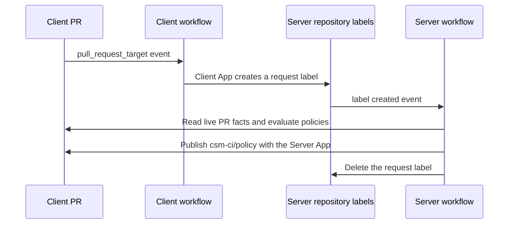

# csm-ci-actions

This repository provides GitHub Actions for CI tasks such as approvals, checks, merges, fixes, and releases without granting broad permissions to client repositories. Client workflows submit requests to a separate server repository. The server holds the write credentials, checks each request against GitHub and its configuration, and applies the permitted change.

This project is **strongly inspired by the [Client-Server Model](https://github.com/csm-actions/docs) and [securefix-action](https://github.com/csm-actions/securefix-action)**. They address the same problem: allowing CI to make useful repository changes without placing powerful write credentials in the workflows that run client code. Their separation of client requests from server-side validation is the foundation of this project's design.

csm-ci-actions extends that approach with approval and policy checks, controlled squash merges, release preparation and publishing, and repository settings reconciliation. Securefix applies generated file changes only after validating their source, paths, content, and current branch head.

Start with the request flow and setup order below, then use the [client](#client-actions) and [server](#server-workflows-and-actions) action references for individual inputs and examples.

Use the [Renovate review skill](.agents/skills/renovate-review/SKILL.md) to assess selected dependency updates and process an authorized batch through the existing Server approval and merge paths. For example, ask `Use $renovate-review to review civitaspo/csm-ci-actions PR #57 in review-only mode.` Grant approval and merge authority separately when those actions are intended.

Pin every action and reusable workflow to a reviewed full commit SHA. Replace `<sha>` in the examples before using them. Keep caller workflows on each repository's default branch.

## How a client request reaches the server

The server runs in GitHub Actions in a separate repository. It does not run an external Webhook receiver. Each client repository needs caller workflows for the operations it uses. Installing the Server App gives the server access to the repository; it does not make the server collect that repository's PR events automatically.

For example, a policy check follows this path:



The client's `.github/workflows/csm-ci-policy-check.yml` calls [`client-policy-check.yml`](.github/workflows/client-policy-check.yml). That workflow runs the [client policy-check action](actions/client/policy-check/README.md) to send the request. The server's `.github/workflows/csm-ci.yml` receives the label event and calls [`server.yml`](.github/workflows/server.yml). Its [intake](actions/server/intake/README.md) validates the request before the [server policy-check action](actions/server/policy-check/README.md) evaluates the PR. Other operations use the same label-based request path, with their own client events and server validation.

## Set up the server

The server needs GitHub Apps and their installations, credentials in its `csm-ci` environment, a `csm-ci.yaml` configuration on its default branch, and caller workflows. Adding `server.yml` alone does not provision these. Follow [setup](docs/setup.md) to register the Apps, store their credentials, and configure trusted identities, repositories, enabled operations, policies, and required checks.

These reusable workflows have separate roles. Add callers in the server repository that invoke them:

| Reusable workflow | Caller event | Role |
| --- | --- | --- |
| [`server.yml`](.github/workflows/server.yml) | `label: created` | Coordinate request validation and processing, including operation stages, token issuance, and cleanup. |
| [`server-check.yml`](.github/workflows/server-check.yml) | `push` and `pull_request` | Validate `csm-ci.yaml` and lint the server workflows. |
| [`server-repo-settings.yml`](.github/workflows/server-repo-settings.yml) | `schedule` and `workflow_dispatch` | Apply repository settings and protection rules, and open PRs for configured managed files. Its execution mode controls which changes it makes. |

A minimal request receiver is `.github/workflows/csm-ci.yml`:

```yaml
name: csm-ci
on:
  label:
    types: [created]
permissions: {}
jobs:
  server:
    uses: civitaspo/csm-ci-actions/.github/workflows/server.yml@<sha>
    secrets: inherit
    permissions:
      contents: read
      issues: write
      id-token: write
      attestations: write
```

Do not add caller-level concurrency that cancels unrelated labels. The reusable workflow owns request serialization. `secrets: inherit` is required for the called jobs' environment credentials. The [setup guide](docs/setup.md#4-add-the-server-workflows) includes the configuration-check caller.

## Enable client repositories in order

Repository protection and file distribution are different parts of setup:

- `controlled-merges` is a GitHub ruleset that limits default-branch updates to PR merges by the Server App, so changes go through the server's `/merge` validation. Other rulesets enforce required checks and release-tag protection.
- `managed-files-only` is an execution mode of the repository-settings workflow. It opens or updates PRs containing files specified by `managed_files` in `csm-ci.yaml`, without changing repository settings or protection rules. Use it to distribute the required client workflows before enabling protection.

Follow this order for a new client:

1. Create and install the Apps and store credentials as described in [setup](docs/setup.md) and [trust and credentials](#trust-and-credentials).
2. Add the target repository and enabled operations to the server's `csm-ci.yaml`. Add the server callers above. Configure `managed_files` with the client workflow files you want to distribute, including the merge and policy-check callers required for protection.
3. Dispatch `server-repo-settings.yml` through its caller with `mode: managed-files-only`. It opens a `csm-ci/repo-settings` PR in each configured target, or the selected `repository`.
4. Review and merge those PRs through the repository's current process. Confirm the client workflows are on the default branch and the configured required checks run.
5. Dispatch the same caller with `mode: reconcile`. It checks the activation prerequisites, applies repository settings and rulesets, and reconciles managed files. A failed activation preflight stops administrative changes.
6. Use `/merge` on PRs during normal operation. The client merge workflow sends the request; the server checks the requester, approval, policies, and required checks before the Server App squash-merges the PR.

The `managed_files` map distributes any configured, permitted file contents as literal text. It does not expand templates or create Apps, installations, variables, or secrets. See [repository settings](docs/repo-settings.md) for the configuration shape and activation prerequisites, and [client callers](docs/setup.md#5-add-the-client-workflows) for the event filters each operation needs. Securefix runs as a step after the client's tools rather than as a separate thin workflow.

Add the following caller to the server's default branch. Manual dispatch defaults to bootstrap; the daily schedule reconciles settings:

```yaml
name: csm-ci-repo-settings
on:
  schedule:
    - cron: '23 3 * * *'
  workflow_dispatch:
    inputs:
      repository:
        description: Optional configured owner/repo target.
        type: string
      mode:
        type: choice
        default: managed-files-only
        options: [managed-files-only, reconcile]
permissions: {}
jobs:
  settings:
    uses: civitaspo/csm-ci-actions/.github/workflows/server-repo-settings.yml@<sha>
    permissions:
      contents: read
    with:
      repository: ${{ inputs.repository || '' }}
      mode: ${{ inputs.mode || 'reconcile' }}
    secrets: inherit
```

Scheduled runs use `reconcile`. They repair settings and managed files while preserving a disabled `controlled-merges` emergency stop; they do not create or activate that ruleset. A manual reconciliation can activate it after preflight succeeds. See [repository settings](docs/repo-settings.md) for drift repair, pending-run replacement, and managed-branch recovery.

## Trust and credentials

A client action creates a `csm-ci-<op>-<random>` label in the server repository. Its description identifies the repository and a pull request or workflow run. The server checks the sender, live label, enabled operation, and first run attempt. It then reads the relevant GitHub facts itself. The cleanup job deletes the request label.

| App | Installed on | Credentials |
| --- | --- | --- |
| `csm-ci-client` | Server repository only | Each client stores `CSM_CI_CLIENT_APP_CLIENT_ID`, `CSM_CI_CLIENT_APP_PRIVATE_KEY`, and `CSM_CI_SERVER_REPOSITORY`. The token has issues write access on the server. |
| `csm-ci-server` | Server and managed client repositories | `CSM_CI_SERVER_APP_CLIENT_ID` and `CSM_CI_SERVER_APP_PRIVATE_KEY` stay in the server's `csm-ci` environment. Jobs mint tokens scoped to their target and required permissions. Discovery lists the installation with metadata read. |
| `csm-ci-approver` | Each target where controlled merges are activated, including the server | `CSM_CI_APPROVER_APP_CLIENT_ID` and `CSM_CI_APPROVER_APP_PRIVATE_KEY` stay in the server's `csm-ci` environment. The App needs pull requests write and contents write for counted approvals. |

The server also needs the client variables, key, and callers when it submits requests for its own pull requests. These variable and secret names are fixed. Testing App names use the `testing-` prefix.

The Server App key is shared by privileged jobs. Narrow tokens limit ordinary use, but do not prevent a compromised job from minting a broader token. Securefix and release preparation expose the Client App key to the job that runs client tools. That key can affect issues and labels in the server repository, so it is not a read-only credential. The server validates requests independently of client tools. Protect write access to the server repository and its `csm-ci` environment.

## How a release moves from a PR to publication

Release publishing starts when a release PR is merged. A tag push is not its entry point. Configure the client entry in the server's `csm-ci.yaml` with the `release` operation and a `release.build_type` of `none`, `js-action`, `goreleaser`, or `cargo`. Preparation also needs the `securefix` operation and a route from the default branch to `release/next`. See [release PR configuration](docs/release-pr.md#server-route) and [build configuration](docs/release.md).

1. The client's [`release-prepare`](actions/client/release-prepare/README.md) runs on a default-branch push or manual dispatch. It generates `.release-version`, the changelog, and supported version edits, then uses securefix to ask the server to create or update the `release/next` PR.
2. Review the PR and request `/merge`. After validation, the Server App merges it into the default branch.
3. The client's [`client-release-publish.yml`](.github/workflows/client-release-publish.yml) handles the merged PR's `pull_request: closed` event and sends a release request through the [client release-publish action](actions/client/release-publish/README.md).
4. The server's [intake](actions/server/intake/README.md) validates the request and enabled operation. [`release-plan`](actions/server/release-plan/README.md) re-reads GitHub facts and requires a same-repository `release/next` PR merged into the default branch by the configured Server bot, with a semantic version in `.release-version` at the merge commit. In the plan job, [`release-tag`](actions/server/release-tag/README.md) creates the annotated `v<version>` tag if absent, before the build starts. An existing tag must match the planned identity and merge commit.
5. [`release-build`](actions/server/release-build/README.md) receives a source archive of that merge commit and runs the configured build in a separate job without secrets or an environment. With `build_type: none`, no client build runs.
6. The publish job uses [`release-assets`](actions/server/release-assets/README.md) to validate outputs and create checksums, then attaches attestations. [`release-publish`](actions/server/release-publish/README.md) creates or resumes a draft, uploads and verifies assets, publishes it, and verifies the immutable release and tag.

The [release guide](docs/release.md) describes tag protection, supported builds, and retry checks. Client workflows request preparation and publication; the server validates the PR and performs the protected writes.

## Client actions

Each action lives under `actions/client/<name>`. Except for securefix, the usual entry point is its thin reusable workflow under `.github/workflows/client-<name>.yml`. Each action creates its own scoped Client App token. All take `client-id`, `private-key`, and `server-repository`; the reusable workflows read the names listed above. Each action reference below lists every input and output, defaults, prerequisites, and a usage example.

| Action | Purpose and caller event | Usage details |
| --- | --- | --- |
| [`approve`](actions/client/approve/README.md) | Request an approval on `pull_request_target` activity or a `/recheck` or `/approve` issue comment. The request job does not check out PR code. | [`client-approve.yml`](.github/workflows/client-approve.yml), [approval rules and force approval](docs/approve.md) |
| [`policy-check`](actions/client/policy-check/README.md) | Request the `csm-ci/policy` check on PR changes, including base edits. | [`client-policy-check.yml`](.github/workflows/client-policy-check.yml), [policies](docs/policy-check.md) |
| [`merge`](actions/client/merge/README.md) | Request a squash merge from an exact `/merge` issue comment. The server checks the requester, approval, policies, and required checks. | [`client-merge.yml`](.github/workflows/client-merge.yml), [merge behavior](docs/merge.md) |
| [`securefix`](actions/client/securefix/README.md) | Package changes made by earlier steps in the same job. Supports same-repository `pull_request`, `push`, and `workflow_dispatch`; fork PRs are skipped. | Direct action step shown below; [workspace, routes, limits, and retries](docs/securefix.md) |
| [`release-prepare`](actions/client/release-prepare/README.md) | Generate a changelog and version edits on a default-branch push or manual dispatch, then request a `release/next` PR through securefix. An optional `version` omits the `v` prefix. | [`client-release-prepare.yml`](.github/workflows/client-release-prepare.yml), [release route and caller example](docs/release-pr.md) |
| [`release-publish`](actions/client/release-publish/README.md) | Request a release when a same-repository `release/next` PR is merged into default. The server validates the merge and release version. | [`client-release-publish.yml`](.github/workflows/client-release-publish.yml), [build types and publishing](docs/release.md) |

A minimal merge caller is `.github/workflows/csm-ci-merge.yml`:

```yaml
name: csm-ci-merge
on:
  issue_comment:
    types: [created]
permissions: {}
jobs:
  merge:
    uses: civitaspo/csm-ci-actions/.github/workflows/client-merge.yml@<sha>
    secrets: inherit
```

Approval and policy-check need their own callers and event filters. Copy them from [setup](docs/setup.md#5-add-the-client-workflows). Release preparation also needs a configured securefix route; enabling the `release` operation alone does not configure it.

Securefix runs after your tools in the same job. This example assumes the repository defines `npm run format`:

```yaml
name: securefix
on:
  pull_request:
permissions: {}
jobs:
  fix:
    runs-on: ubuntu-24.04
    permissions:
      contents: read
    steps:
      - uses: actions/checkout@3d3c42e5aac5ba805825da76410c181273ba90b1 # v7.0.1
        with:
          ref: ${{ github.event.pull_request.head.sha }}
          persist-credentials: false
      - run: npm ci --ignore-scripts
      - run: npm run format
      - uses: civitaspo/csm-ci-actions/actions/client/securefix@<sha>
        with:
          client-id: ${{ vars.CSM_CI_CLIENT_APP_CLIENT_ID }}
          private-key: ${{ secrets.CSM_CI_CLIENT_APP_PRIVATE_KEY }}
          server-repository: ${{ vars.CSM_CI_SERVER_REPOSITORY }}
```

Use the PR head SHA, not GitHub's synthetic merge commit. For another checkout directory, pass `workspace`. If no files changed, securefix sends no request. Do not use `pull_request_target` for this tool job. The [securefix guide](docs/securefix.md) describes the server-side checks and permitted paths.

## Server workflows and actions

The reusable workflows coordinate validation, token issuance, job isolation, and cleanup. Use the workflows described in [server setup](#set-up-the-server) as the entry points. Individual server actions are stages within them.

The server actions live under `actions/server/<name>`:

| Action | Stage and use |
| --- | --- |
| [`intake`](actions/server/intake/README.md) | Validate the live label and emit the normalized request for `server.yml`. |
| [`approve`](actions/server/approve/README.md) | Check commit trust and policies, then approve through the Approver App. [Approval details](docs/approve.md). |
| [`policy-check`](actions/server/policy-check/README.md) | Publish the server-owned `csm-ci/policy` check. [Policy details](docs/policy-check.md). |
| [`merge`](actions/server/merge/README.md) | Wait for readiness, revalidate with fresh tokens, squash merge, and report the result. [Merge details](docs/merge.md). |
| [`securefix`](actions/server/securefix/README.md) | Validate the source run and artifact, then apply bounded changes with expected-head checks. [Securefix details](docs/securefix.md). |
| [`release-plan`](actions/server/release-plan/README.md) | Verify the merged release PR and emit the release plan. |
| [`release-build`](actions/server/release-build/README.md) | Build with `build-type: none`, `js-action`, `goreleaser`, or `cargo` in the workflow's isolated job without secrets or an environment. |
| [`release-assets`](actions/server/release-assets/README.md) | Validate build outputs and create `SHA256SUMS` without executing client code. |
| [`release-tag`](actions/server/release-tag/README.md) | Create the planned annotated tag when absent. |
| [`release-publish`](actions/server/release-publish/README.md) | Create or complete the draft, publish, and verify the immutable release's assets and tag. |
| [`repo-settings`](actions/server/repo-settings/README.md) | Validate context, discover targets, inspect and apply settings, and reconcile managed-file PRs. The reusable workflow selects the stages and tokens. [Repository settings details](docs/repo-settings.md). |
| [`check-config`](actions/server/check-config/README.md) | Validate a local `csm-ci.yaml` against this revision's schema. Used by `server-check.yml`. |

The [release guide](docs/release.md) describes the five release stages, build configuration, and replay behavior. [Release attestations](docs/release-attestation.md) describe provenance. Each linked action reference includes all inputs and outputs and a usage example. Server examples identify the earlier workflow stage that produces each required value; use the coordinating reusable workflow to preserve these boundaries.

## Development

Follow [AGENTS.md](AGENTS.md) when contributing. The [specification](docs/first-release-plan.md) defines the supported behavior. Source entry points are `src/<side>-<name>/main.ts`; committed bundles are `dist/<side>-<name>.js`.

The [repository CI structure](docs/ci.md) describes the event entries, reusable checks, and required `status-check`.

Install [mise](https://mise.jdx.dev/) and use the tool versions in [mise.toml](mise.toml). Run the required checks:

```sh
mise install
bun install --frozen-lockfile --ignore-scripts
bun run typecheck
bun test
bun run build
test -z "$(git status --porcelain dist/)"
mise exec -- jactionlint
```

When a source change updates bundles, review and commit the regenerated `dist/` files. The clean-dist check must pass before opening the PR. Keep rejection cases table-driven, assert their error messages, and mutation-check each new or changed rule. Give each mutant a timeout and restore from copies taken before the first mutation. Obtain an independent review against the specification.

### Run live e2e in the testing repositories

The harness uses only `civitaspo/testing-csm-ci-client` and `civitaspo/testing-csm-ci-server` as targets. It moves the `e2e` branch in `civitaspo/csm-ci-actions` to the supplied revision and synchronizes test fixture workflows. These are live writes, not a local simulation.

Prerequisites are a signed, pushed full commit SHA; the testing Apps, configuration, variables, and secrets from [setup](docs/setup.md); and an authenticated `gh` session with the required access to all three repositories. `GH_TOKEN` acts as the testing owner. `CSM_CI_ACTIONS_TOKEN`, when set, handles the actions repository's branch and lock; otherwise the harness uses `GH_TOKEN` for both. Credential provisioning is an operator task.

Run one feature suite at a time, then smoke:

```sh
GH_TOKEN=$(gh auth token) bun e2e/run.ts --ref <full-sha> --feature repo-settings
GH_TOKEN=$(gh auth token) bun e2e/run.ts --ref <full-sha> --feature smoke
```

Available features are `approve`, `merge`, `policy-check`, `securefix`, `release`, `release-pr`, `repo-settings`, and `smoke`. The feature name remains `release-pr` even though its client action is named `release-prepare`. Record run URLs and any skips in the PR.

The local runner skips scenarios that need `CSM_CI_UNTRUSTED_COMMITTER_TOKEN`. The [CI e2e workflow](.github/workflows/e2e.yml) supplies that second identity from its preconfigured `csm-ci-e2e` environment. After merge, dispatch the affected suites and smoke sequentially from `main`, testing the merged SHA:

```sh
gh workflow run e2e.yml --repo civitaspo/csm-ci-actions --ref main \
  -f ref=<merged-full-sha> -f feature=repo-settings
```

Wait for completion before dispatching the next suite. The harness lock and workflow concurrency protect shared state, but a newer queued GitHub run can replace an older pending run.

Scenarios restore temporary configuration and administrative state in cleanup paths and verify restoration where applicable. A failed API call or killed process can leave state behind. If a run is interrupted, first ensure it and its dispatched workflows have stopped. Inspect restoration diagnostics, verify ownership of leftover test objects, close owned `e2e-*` PRs, and remove the stale `e2e-lock` label before restarting. Do not delete a ruleset by name alone or reset an unverified managed branch. Changed-content resets of existing managed branches are excluded from the live verification procedure. Keep that limitation explicit when reporting results.

## License

[MIT](LICENSE)
